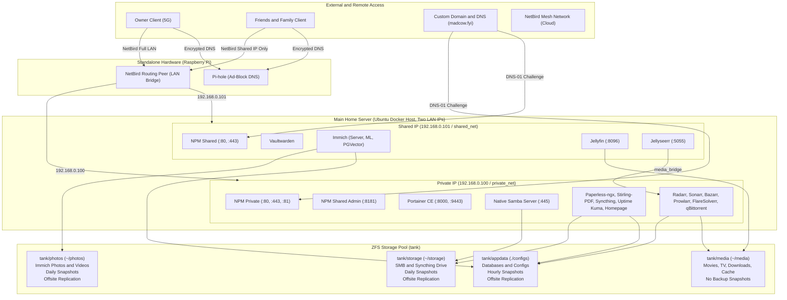

# Automated Homelab and Media Server

This repository holds a homelab setup that runs on Docker Compose and native Linux services. The design uses ZFS snapshots, atomic hardlinks (TRaSH Guides), and two LAN IP addresses to isolate private services from shared services. It also includes a Samba network drive, Syncthing file sync, and an isolated DNS and VPN node.

---

## Architecture Overview



---

## Services Directory

| Category | Service | LAN IP | Host Port | Access URL | Purpose |
| :--- | :--- | :--- | :--- | :--- | :--- |
| **Proxy and Admin** | [Nginx Proxy Manager (Private)](https://nginxproxymanager.com) | `PRIVATE_IP` | `80`, `443`, `81` | `http://<private-ip>:81` | Private reverse proxy and SSL |
| | [Nginx Proxy Manager (Shared)](https://nginxproxymanager.com) | `SHARED_IP` / `PRIVATE_IP` | `80`/`443` (`SHARED_IP`), `8181` (`PRIVATE_IP`) | `http://<private-ip>:8181` | Shared reverse proxy for guests |
| | [Portainer CE](https://www.portainer.io) | `PRIVATE_IP` | `8000`, `9443` | `https://<private-ip>:9443` | Web interface for Docker containers |
| **Storage and Drive** | [Samba (Native SMB)](https://www.samba.org) | `PRIVATE_IP` | `445`, `139` | `smb://<private-ip>/HomeDrive` | Local network drive |
| | [Syncthing](https://syncthing.net) | `PRIVATE_IP` | `8384` | `http://<private-ip>:8384` | File sync and offline drive |
| **Shared Services** | [Vaultwarden](https://github.com/dani-garcia/vaultwarden) | `SHARED_IP` | Via NPM Shared | `https://vault.<domain>` | Self-hosted Bitwarden password vault |
| | [Immich](https://immich.app) | `SHARED_IP` | `2283` | `http://<shared-ip>:2283` | Self-hosted photo and video backup |
| | [Jellyfin](https://jellyfin.org) | `SHARED_IP` | `8096` | `http://<shared-ip>:8096` | Open-source media server |
| | [Jellyseerr](https://github.com/Fallenbagel/jellyseerr) | `SHARED_IP` | `5055` | `http://<shared-ip>:5055` | Media request interface |
| **Private Documents** | [Paperless-ngx](https://docs.paperless-ngx.com) | `PRIVATE_IP` | `8777` | `http://<private-ip>:8777` | Document archive and OCR system |
| | [Stirling-PDF](https://github.com/Stirling-Tools/Stirling-PDF) | `PRIVATE_IP` | `8085` | `http://<private-ip>:8085` | Local PDF tool suite |
| **Monitoring** | [Uptime Kuma](https://github.com/louislam/uptime-kuma) | `PRIVATE_IP` | `3001` | `http://<private-ip>:3001` | Service status monitor |
| | [Homepage](https://gethomepage.dev) | `PRIVATE_IP` | `3000` | `http://<private-ip>:3000` | Application dashboard |
| **Media Automation** | [Radarr](https://radarr.video) | `PRIVATE_IP` | `7878` | `http://<private-ip>:7878` | Movie collection manager |
| | [Sonarr](https://sonarr.tv) | `PRIVATE_IP` | `8989` | `http://<private-ip>:8989` | TV series collection manager |
| | [Bazarr](https://www.bazarr.media) | `PRIVATE_IP` | `6767` | `http://<private-ip>:6767` | Subtitle manager for Sonarr and Radarr |
| | [Prowlarr](https://prowlarr.com) | `PRIVATE_IP` | `9696` | `http://<private-ip>:9696` | Torrent and Usenet indexer proxy |
| | [qBittorrent](https://www.qbittorrent.org) | `PRIVATE_IP` | `8080`, `6881` | `http://<private-ip>:8080` | Torrent download client |
| | [FlareSolverr](https://github.com/FlareSolverr/FlareSolverr) | `PRIVATE_IP` | `8191` | `http://<private-ip>:8191` | Cloudflare solver for indexers |

---

## Storage Architecture and ZFS Dataset Layout

The storage layout separates critical application state, personal photos, personal documents, and disposable media into four ZFS datasets:

```
ZFS Storage Pool (tank)
├── tank/appdata (Mounted to ./configs inside ~/home-lab)
│   ├── Settings, SQLite databases (Vaultwarden, Sonarr, Radarr, Prowlarr)
│   ├── Immich PostgreSQL database & pgvector data
│   ├── Paperless SQLite metadata & NPM certificates
│   └──> SNAPSHOT THIS! (Lightweight, ~5-20 GB, hourly snapshots, replicated offsite)
│
├── tank/photos (Mounted to ~/photos)
│   ├── Immich photo and video libraries (family memories)
│   └──> SNAPSHOT & BACKUP THIS! (Daily snapshots, replicated offsite)
│
├── tank/storage (Mounted to ~/storage)
│   ├── Native Samba SMB share (Live network drive)
│   ├── Syncthing storage folder (Offline laptop sync)
│   └──> SNAPSHOT & BACKUP THIS! (Daily snapshots, replicated offsite)
│
└── tank/media (Mounted to ~/media)
    ├── downloads/       (qBittorrent active & completed downloads)
    ├── movies/          (Curated movie library)
    ├── tv/              (Curated TV show library)
    └── cache/
        ├── jellyfin/    (Transcoding chunks & image cache)
        └── immich-ml/   (Downloaded machine learning model cache)
    └──> EXCLUDED FROM BACKUP SNAPSHOTS (Multi-terabyte disposable media)
```

---

## Setup Procedure

### Step 1: Install Host System Packages

1. On a new Ubuntu Server installation, run these commands to update packages and install Docker, ZFS, and Samba:

```bash
# Update system packages
sudo apt update && sudo apt upgrade -y

# Install Docker engine and Compose plugin
curl -fsSL https://get.docker.com | sh
sudo usermod -aG docker $USER

# Install ZFS utilities and Samba
sudo apt install -y zfsutils-linux samba

# Apply docker group change to current session
newgrp docker

# Check installations
docker --version
docker compose version
zfs --version
```

2. Run these commands to check your user UID and GID:

```bash
id -u  # Expected: 1000
id -g  # Expected: 1000
```

3. If your UID or GID is not `1000`, update `PUID` and `PGID` in the `.env` file.

---

### Step 2: Set Up Two LAN IP Addresses on the Server (Netplan)

The server uses two static LAN IP addresses on one network interface to isolate private tools from shared media services:

* `192.168.0.100` (`PRIVATE_IP`): Private admin UIs, personal storage, and the Private NPM proxy.
* `192.168.0.101` (`SHARED_IP`): Jellyfin, Jellyseerr, Immich, Vaultwarden, and the Shared NPM proxy.

1. Run this command to find your active network interface name and Netplan file:

```bash
ip -br link
ls /etc/netplan/
```

2. Open your Netplan YAML file (for example, `/etc/netplan/50-cloud-init.yaml` or `/etc/netplan/00-installer-config.yaml`):

```bash
sudo nano /etc/netplan/<your-netplan-file>.yaml
```

3. Set two static IP addresses under `addresses` (replace `<interface>` and gateway IP with your network values):

```yaml
network:
  version: 2
  ethernets:
    <interface>:
      dhcp4: false
      addresses:
        - 192.168.0.100/24
        - 192.168.0.101/24
      routes:
        - to: default
          via: 192.168.0.1
      nameservers:
        addresses:
          - 192.168.0.50
```

4. Apply the Netplan configuration and check that both IP addresses appear on the interface:

```bash
sudo netplan try
sudo netplan apply
ip -4 addr show <interface>
```

5. In your router admin panel, exclude `192.168.0.100` and `192.168.0.101` from the DHCP range (or reserve both IP addresses).

---

### Step 3: Make the ZFS Pool

1. List your storage drives by their persistent disk IDs so drive names stay consistent after a reboot:

```bash
ls -l /dev/disk/by-id/
```

2. Make the ZFS storage pool named `tank`:

```bash
# For a two-drive mirror setup (recommended):
sudo zpool create -o ashift=12 -O compression=lz4 tank mirror \
    /dev/disk/by-id/<drive-1-id> \
    /dev/disk/by-id/<drive-2-id>

# For a single-drive setup:
# sudo zpool create -o ashift=12 -O compression=lz4 tank /dev/disk/by-id/<drive-id>

# Check pool status
sudo zpool status tank
```

---

### Step 4: Clone the Repository

1. Clone this repository into your home directory before you make the ZFS dataset mountpoints:

```bash
git clone <your-repo-url> ~/home-lab
cd ~/home-lab
```

---

### Step 5: Prepare Storage Datasets and Directories

1. Run these commands to make the ZFS datasets, media subdirectories, and user permissions:

```bash
# 1. Appdata dataset (databases and container state: atime off, system attributes on)
sudo zfs create -o compression=lz4 -o atime=off -o xattr=sa -o mountpoint=/home/$USER/home-lab/configs tank/appdata

# 2. Photos dataset (Immich photo and video libraries: backed up)
sudo zfs create -o compression=lz4 -o atime=off -o mountpoint=/home/$USER/photos tank/photos

# 3. Personal storage dataset (SMB share and Syncthing offline drive: backed up)
sudo zfs create -o compression=lz4 -o atime=off -o mountpoint=/home/$USER/storage tank/storage

# 4. Bulk media dataset (1M recordsize for video streams: not backed up)
sudo zfs create -o compression=lz4 -o recordsize=1M -o mountpoint=/home/$USER/media tank/media

# 5. Make media subdirectories and isolated transcode caches
mkdir -p ~/media/downloads
mkdir -p ~/media/movies
mkdir -p ~/media/tv
mkdir -p ~/media/cache/jellyfin
mkdir -p ~/media/cache/immich-ml

# 6. Give ownership of all datasets to your user
sudo chown -R $USER:$USER /home/$USER/home-lab/configs /home/$USER/photos /home/$USER/storage /home/$USER/media
```

---

### Step 6: Set Up Personal Cloud Storage (SMB and Syncthing)

Both the Samba network drive (SMB) and offline file sync (Syncthing) use the same ZFS dataset (`~/storage`).

#### A. Set Up Samba (SMB Share)

1. Open `/etc/samba/smb.conf`:

```bash
sudo nano /etc/samba/smb.conf
```

2. Under `[global]`, restrict Samba to `PRIVATE_IP` so it does not listen on `SHARED_IP`:

```ini
[global]
    interfaces = 192.168.0.100
    bind interfaces only = yes
```

3. Add this share block to the bottom of the file:

```ini
[HomeDrive]
    comment = Personal Cloud Storage (ZFS)
    path = /home/%u/storage
    read only = no
    browsable = yes
    valid users = %u
    create mask = 0664
    directory mask = 0775
```

> [!NOTE]
> The `%u` macro expects the client username to match the Linux username. If a client uses a different username, replace `%u` with your Linux username (for example, `username`).

4. Set your Samba password and restart the Samba service:

```bash
sudo smbpasswd -a $USER
sudo systemctl restart smbd
```

5. Connect to the share from Windows (`\\<private-ip>\HomeDrive`), macOS (`smb://<private-ip>/HomeDrive`), or a mobile file app.

#### B. Set Up Syncthing (Offline Sync)

1. Open `http://<private-ip>:8384`.
2. Install the Syncthing client on your laptop.
   * Syncthing maps `/storage` directly to `~/storage`.
   * When your laptop connects to the network, Syncthing sends changes to the server.
   * ZFS snapshots then protect the updated files.
3. In the Syncthing folder settings, add these lines to **Ignore Patterns** (`.stignore`) so OS metadata files do not sync:
   ```
   (?d).DS_Store
   (?d)Thumbs.db
   (?d)._*
   (?d).sync
   ```

---

### Step 7: Set Up Environment Variables and Dashboard Templates

1. Copy the environment template file and restrict its permissions:

```bash
cd ~/home-lab
cp example.env .env
chmod 600 .env
```

2. Open `.env` in an editor:

```bash
nano .env
```

3. Set these variables in `.env`:
   * `PRIVATE_IP`: Private LAN IP address of your server (for example, `192.168.0.100`).
   * `SHARED_IP`: Shared LAN IP address of your server (for example, `192.168.0.101`).
   * `IMMICH_DB_PASSWORD`: Random password made with `openssl rand -hex 16`.
   * `PAPERLESS_SECRET_KEY`: Random secret key made with `openssl rand -hex 16`.
   * `VAULTWARDEN_DOMAIN`: Public URL (for example, `https://vault.madcow.fyi/`).
   * `VAULTWARDEN_SIGNUPS_ALLOWED`: Set to `true` only to register your admin account, then set back to `false`.

4. Copy the starter templates for Homepage into the config directory:

```bash
mkdir -p ./configs/homepage/config
cp -r templates/homepage/* ./configs/homepage/config/
```

---

### Step 8: Start the Stack

1. Check the Compose syntax, start all containers, and check their status:

```bash
# Check compose syntax
docker compose config

# Start all containers in detached mode
docker compose up -d

# Check container status
docker compose ps
```

---

### Step 9: Set Up Both Nginx Proxy Manager Instances and SSL

> [!NOTE]
> This setup does not expose your server to the public internet. Both NPM containers use the Cloudflare DNS-01 challenge to get wildcard SSL certificates with no open router ports.
>
> If your router uses DNS Rebinding Protection, it can block public domains that point to private LAN IP addresses. Add `madcow.fyi` to your router exceptions list, or add local DNS records in Pi-hole.

#### A. Set Up Private NPM (`http://<private-ip>:81`)

1. Open `http://<private-ip>:81`.
2. Log in with the default credentials (`admin@example.com` and `changeme`), then change your email and password.
3. Add a wildcard Let's Encrypt certificate for `*.madcow.fyi` and `madcow.fyi` with **Use a DNS Challenge** and **Cloudflare**.
4. Add proxy hosts **only for private services** on `private_net`:
   * `portainer.madcow.fyi` -> `portainer` port `9000` (or HTTPS port `9443`)
   * `paperless.madcow.fyi` -> `paperless-ngx` port `8000`
   * `sonarr.madcow.fyi` -> `sonarr` port `8989`
   * `radarr.madcow.fyi` -> `radarr` port `7878`
   * `prowlarr.madcow.fyi` -> `prowlarr` port `9696`
   * `qbit.madcow.fyi` -> `qbittorrent` port `8080`
5. On the **SSL** tab for each host, select your wildcard certificate and turn on **Force SSL**, **HTTP/2**, and **Websockets Support**.

#### B. Set Up Shared NPM (`http://<private-ip>:8181`)

The `npm-shared` admin interface binds only to `PRIVATE_IP` (`:8181`), while its HTTPS traffic binds to `SHARED_IP` (`:443`).

1. Open `http://<private-ip>:8181`.
2. Log in with the default credentials (`admin@example.com` and `changeme`), then change your email and password.
3. Add a wildcard Let's Encrypt certificate for `*.madcow.fyi` and `madcow.fyi` with **Use a DNS Challenge** and **Cloudflare**.
4. Add proxy hosts **only for shared services** on `shared_net`:
   * `jellyfin.madcow.fyi` -> `jellyfin` port `8096`
   * `requests.madcow.fyi` -> `jellyseerr` port `5055`
   * `photos.madcow.fyi` -> `immich-server` port `2283`
   * `vault.madcow.fyi` -> `vaultwarden` port `80`
5. On the **SSL** tab for each host, select your wildcard certificate and turn on **Force SSL**, **HTTP/2**, and **Websockets Support**.

---

### Step 10: Set Up Core Services

1. **Vaultwarden**:
   * Open `https://vault.madcow.fyi` and register your admin account.
   * Edit `.env` and set `VAULTWARDEN_SIGNUPS_ALLOWED=false`.
   * Restart the container to lock signups:
     ```bash
     docker compose up -d vaultwarden
     ```
2. **Immich**:
   * Open `http://<shared-ip>:2283` and make the administrator account.
   * Immich saves uploaded photos in `~/photos` (`tank/photos`).
3. **Paperless-ngx**:
   * Open `http://<private-ip>:8777`.
   * Run this command to make an administrator user:
     ```bash
     docker compose exec -it paperless-ngx python3 manage.py createsuperuser
     ```

---

### Step 11: Set Up the Media Stack and TRaSH Hardlinks

1. **qBittorrent (`http://<private-ip>:8080`)**:
   * Get the temporary password from the container logs:
     ```bash
     docker compose logs qbittorrent | grep -i password
     ```
   * Log in with username `admin` and the temporary password.
   * Go to **Tools** -> **Options** -> **Web UI** and change your password.
   * Go to **Tools** -> **Options** -> **Downloads** and set these paths:
     * **Default Save Path**: `/data/downloads`
     * **Incomplete Save Path**: `/data/downloads/incomplete`
2. **Sonarr (`:8989`) and Radarr (`:7878`)**:
   * Add root folder `/data/movies` in Radarr and `/data/tv` in Sonarr.
   * Add qBittorrent as the download client (`host: qbittorrent`, `port: 8080`).
   * Set the category to `tv` in Sonarr and `movies` in Radarr.
3. **Jellyfin (`http://<shared-ip>:8096`)**:
   * Add library paths `/data/movies` and `/data/tv` (mounted read-only to protect media files).
   * Go to **Dashboard** -> **Playback** -> **Transcoding** and set the transcode path to `/cache`.

For complete instructions on indexers, subtitles, and GPU transcoding, see [docs/media-stack-guide.md](docs/media-stack-guide.md).

---

### Step 12: Set Up the Standalone Raspberry Pi (Pi-hole and NetBird)

This Raspberry Pi keeps home DNS online at all times, even during server maintenance.

1. Flash Raspberry Pi OS Lite on your Pi and assign a static DHCP reservation (for example, `192.168.0.50`).
2. Run `curl -sSL https://install.pi-hole.net | bash` to install Pi-hole.
3. Install NetBird, set Linux IP forward to on, and connect the Pi to NetBird Cloud:
   ```bash
   curl -fsSL https://pkgs.netbird.io/install.sh | sh
   sudo netbird up
   ```
4. In NetBird Cloud, add `192.168.0.0/24` (full LAN for owner devices) and `192.168.0.101/32` (`SHARED_IP` for friends and family) under **Networks**.
5. Select the Pi as the Routing Peer for both network resources.
6. Set the NetBird IP address of the Pi as the DNS nameserver.
7. Map shared subdomains to `SHARED_IP` and private subdomains to `PRIVATE_IP` in Pi-hole Local DNS.

For detailed instructions, see [docs/pihole-netbird-guide.md](docs/pihole-netbird-guide.md).

---

### Step 13: Take ZFS Snapshots and Prepare Backups

Container state resides in `tank/appdata`, photos reside in `tank/photos`, and personal documents reside in `tank/storage`.

1. Run these commands to take manual snapshots and list all snapshots:

```bash
# Take manual snapshots of critical datasets
sudo zfs snapshot tank/appdata@manual-$(date +%F)
sudo zfs snapshot tank/photos@manual-$(date +%F)
sudo zfs snapshot tank/storage@manual-$(date +%F)

# List snapshots
sudo zfs list -t snapshot
```

To set up automatic snapshot retention with Sanoid and offsite replication with Syncoid, see [docs/zfs-backup-guide.md](docs/zfs-backup-guide.md).
