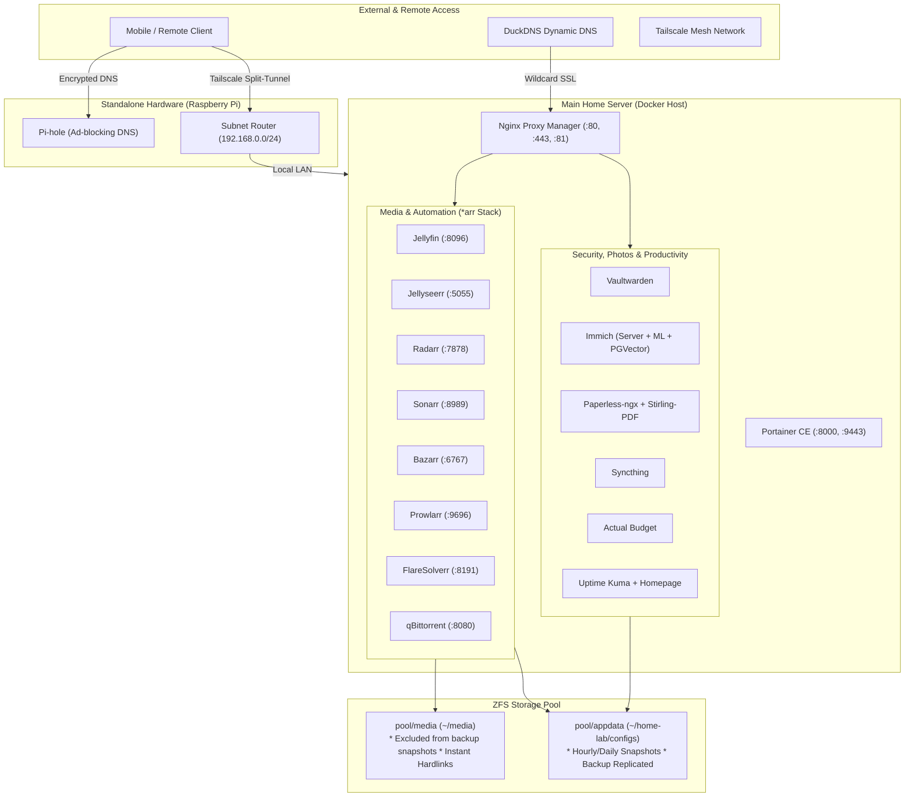

# 🏠 Automated Homelab & Media Server

A complete, production-grade homelab infrastructure managed entirely via Docker Compose. Engineered around **ZFS snapshot efficiency**, **zero-copy atomic hardlinks (TRaSH Guides)**, **secure SSL reverse proxying**, and **isolated DNS/VPN infrastructure**.

---

## 📑 Architecture Overview



---

## 🗂️ Services Directory

| Category | Service | Container Port | Host Port | Web UI URL | Purpose |
| :--- | :--- | :--- | :--- | :--- | :--- |
| **Proxy & Admin** | [Nginx Proxy Manager](https://nginxproxymanager.com) | `80`, `443`, `81` | `80:80`, `443:443`, `81:81` | `http://<ip>:81` | SSL termination & reverse proxy |
| | [Portainer CE](https://www.portainer.io) | `8000`, `9443` | `8000:8000`, `9443:9443` | `https://<ip>:9443` | Docker container management GUI |
| **Security** | [Vaultwarden](https://github.com/dani-garcia/vaultwarden) | `80` | Via NPM | `https://vault.<domain>` | Self-hosted Bitwarden password vault |
| **Photos & Documents** | [Immich](https://immich.app) | `2283` | `2283:2283` | `http://<ip>:2283` | Self-hosted Google Photos alternative |
| | [Paperless-ngx](https://docs.paperless-ngx.com) | `8000` | `8777:8000` | `http://<ip>:8777` | Document archival & OCR system |
| | [Stirling-PDF](https://github.com/Stirling-Tools/Stirling-PDF) | `8080` | `8085:8080` | `http://<ip>:8085` | Local PDF manipulation swiss-army knife |
| **Sync & Finance** | [Syncthing](https://syncthing.net) | `8384` | `8384:8384` | `http://<ip>:8384` | Decentralized continuous file sync |
| | [Actual Budget](https://actualbudget.org) | `5006` | `5006:5006` | `http://<ip>:5006` | Local-first personal finance & budgeting |
| **Monitoring** | [Uptime Kuma](https://github.com/louislam/uptime-kuma) | `3001` | `3001:3001` | `http://<ip>:3001` | Service uptime & status page |
| | [Homepage](https://gethomepage.dev) | `3000` | `3000:3000` | `http://<ip>:3000` | Application dashboard |
| **Media Automation** | [Jellyfin](https://jellyfin.org) | `8096` | `8096:8096` | `http://<ip>:8096` | Open-source media streaming server |
| | [Jellyseerr](https://github.com/Fallenbagel/jellyseerr) | `5055` | `5055:5055` | `http://<ip>:5055` | Media request and discovery UI |
| | [Radarr](https://radarr.video) | `7878` | `7878:7878` | `http://<ip>:7878` | Movies collection automation |
| | [Sonarr](https://sonarr.tv) | `8989` | `8989:8989` | `http://<ip>:8989` | TV series collection automation |
| | [Bazarr](https://www.bazarr.media) | `6767` | `6767:6767` | `http://<ip>:6767` | Subtitle manager for Sonarr/Radarr |
| | [Prowlarr](https://prowlarr.com) | `9696` | `9696:9696` | `http://<ip>:9696` | Torrent/Usenet indexer proxy |
| | [qBittorrent](https://www.qbittorrent.org) | `8080`, `6881` | `8080:8080`, `6881:6881` | `http://<ip>:8080` | Torrent download client |
| | [FlareSolverr](https://github.com/FlareSolverr/FlareSolverr) | `8191` | `8191:8191` | Internal API | Cloudflare challenge solver for indexers |

---

## 💾 Storage Architecture & ZFS Snapshot Design

The core storage layout strictly separates **lightweight critical application state** from **heavy disposable media**:

```
ZFS Storage Pool (tank or pool)
├── tank/appdata (Mounted to ~/home-lab/configs)
│   ├── actual-budget/
│   ├── bazarr/
│   ├── homepage/
│   ├── immich/          (postgres DB + vector data + upload configs)
│   ├── jellyfin/        (ONLY database, settings, and watch history)
│   ├── jellyseerr/
│   ├── npm/             (Nginx Proxy Manager DB & SSL certificates)
│   ├── paperless/       (data & export)
│   ├── portainer/
│   ├── prowlarr/
│   ├── qbittorrent/     (qBittorrent.conf & .fastresume state)
│   ├── radarr/
│   ├── sonarr/
│   ├── syncthing/
│   ├── uptime-kuma/
│   └── vaultwarden/     (SQLite DB + encrypted vault data)
│   └──> SNAPSHOT THIS! (Lightweight, fast, replicated offsite)
│
└── tank/media (Mounted to ~/media)
    ├── downloads/       (Torrents: staging, active, completed)
    ├── movies/          (Curated movie library)
    ├── tv/              (Curated TV show library)
    └── cache/
        └── jellyfin/    (Transcoding chunks & image cache)
    └──> EXCLUDED FROM BACKUP SNAPSHOTS! (Terabytes of reproducible media)
```

### Why this structure matters

1. **ZFS Snapshots are instantaneous & tiny**: Taking a snapshot of `tank/appdata` takes milliseconds and consumes only a few megabytes. You can take hourly snapshots, retain 30 days of history, and replicate to an offsite server or cloud without transferring video files.
2. **Jellyfin cache isolation**: Jellyfin's `/cache` is explicitly mounted to `~/media/cache/jellyfin:/cache`. Transcoding chunks and trickplay thumbnails never pollute the `tank/appdata` snapshot dataset.
3. **TRaSH Guides Instant Hardlinks**: `qbittorrent`, `radarr`, and `sonarr` all share the exact same root mount `${MEDIA_DIR:-~/media}:/data`. When Sonarr or Radarr imports a finished download, the Linux kernel creates an **atomic hardlink** in milliseconds with **zero extra disk space** used.

---

## 🚀 Step-by-Step Setup Guide (Step 1 to Final)

### Step 1: Host System & Docker Installation

On your Ubuntu/Debian server:

```bash
# Update system packages
sudo apt update && sudo apt upgrade -y

# Install Docker using the official convenience script
curl -fsSL https://get.docker.com | sh

# Allow your user to run Docker without sudo
sudo usermod -aG docker $USER
newgrp docker

# Verify Docker and Compose V2 installation
docker --version
docker compose version
```

Verify your user's UID and GID:

```bash
id -u  # Expected: 1000
id -g  # Expected: 1000
```

*(If your UID/GID is not `1000:1000`, update `PUID` and `PGID` in `x-common-env` inside `docker-compose.yml`).*

---

### Step 2: Storage Preparation (ZFS or Standard Directories)

#### Option A: With ZFS (Recommended)

```bash
# Create the appdata dataset for configs
sudo zfs create -o mountpoint=/home/$USER/home-lab/configs tank/appdata

# Create the bulk media dataset
sudo zfs create -o mountpoint=/home/$USER/media tank/media

# Ensure permissions belong to your user
sudo chown -R $USER:$USER /home/$USER/home-lab/configs /home/$USER/media
```

#### Option B: Without ZFS (Standard Filesystem)

```bash
mkdir -p ~/home-lab/configs
mkdir -p ~/media
```

#### Create the standard media subdirectories

```bash
mkdir -p ~/media/downloads
mkdir -p ~/media/movies
mkdir -p ~/media/tv
mkdir -p ~/media/cache/jellyfin
```

---

### Step 3: Environment Setup

Clone this repository and create your `.env` file:

```bash
cd ~/home-lab
cp example.env .env
chmod 600 .env
```

Open `.env` and fill in your values:

```bash
nano .env
```

Key variables to review:

* `IMMICH_DB_PASSWORD`: Set a strong random password for PostgreSQL (e.g. `openssl rand -hex 16`).
* `VAULTWARDEN_DOMAIN`: Set your public Vaultwarden URL (e.g. `https://vault.yourdomain.duckdns.org/`).
* `VAULTWARDEN_SIGNUPS_ALLOWED`: Keep `true` for initial account registration, then set to `false`.
* `DUCKDNS_KEY`: Your DuckDNS account token.
* `MEDIA_DIR`: Path to your media dataset (defaults to `~/media`).

---

### Step 4: Launching the Stack

Validate the configuration:

```bash
docker compose config
```

Start all services in detached mode:

```bash
docker compose up -d
```

Monitor initial container startup:

```bash
docker compose ps
docker compose logs -f
```

---

### Step 5: Nginx Proxy Manager & SSL Setup

1. Open your browser and navigate to `http://<server-ip>:81`.
2. **Default login credentials**:
   * **Email**: `admin@example.com`
   * **Password**: `changeme`
3. Immediately change your email and admin password when prompted.
4. **Create a Wildcard Let's Encrypt Certificate**:
   * Navigate to **SSL Certificates** → **Add SSL Certificate** → **Let's Encrypt**.
   * Domain Names: `*.yourdomain.duckdns.org`, `yourdomain.duckdns.org`.
   * Enable **Use a DNS Challenge**.
   * DNS Provider: **DuckDNS**.
   * Fill in your `DUCKDNS_KEY` token in the credential box.
   * Agree to the terms and click **Save**.
5. **Add Proxy Hosts for your services**:
   * Navigate to **Hosts** → **Proxy Hosts** → **Add Proxy Host**.
   * Example for Vaultwarden:
     * Domain: `vault.yourdomain.duckdns.org`
     * Scheme: `http`
     * Forward Hostname: `vaultwarden` (Use Docker internal container name!)
     * Forward Port: `80`
     * Enable **Block Common Exploits** and **Websockets Support**.
     * Under the **SSL** tab: Select your Wildcard Certificate, enable **Force SSL** and **HTTP/2**.

---

### Step 6: Initial Core Services Configuration

1. **Vaultwarden**:
   * Access `https://vault.yourdomain.duckdns.org` and create your master vault account.
   * Once created, set `VAULTWARDEN_SIGNUPS_ALLOWED=false` in `.env` and run `docker compose up -d vaultwarden` to lock signups.
2. **Immich**:
   * Open `http://<server-ip>:2283` and complete the initial administrator setup.
   * Download the Immich mobile app on iOS/Android, enter your server URL, and enable automatic background backup.
3. **Paperless-ngx**:
   * Open `http://<server-ip>:8777`.
   * Create an initial superuser by running:

     ```bash
     docker compose exec -it paperless-ngx python3 manage.py createsuperuser
     ```

   * Log in and configure your document tags, correspondents, and document types.

---

### Step 7: Media Automation Stack Configuration

To enable instant hardlinks, follow the standard TRaSH Guides paths:

1. **qBittorrent (`http://<server-ip>:8080`)**:
   * Default credentials: `admin` / `adminadmin` (or check container logs for temporary password).
   * Go to **Tools** → **Options** → **Downloads**:
     * Default Save Path: `/data/downloads`
     * Keep incomplete torrents in: `/data/downloads/incomplete`
2. **Prowlarr (`http://<server-ip>:9696`)**:
   * Settings → Indexers → Add FlareSolverr (`http://flaresolverr:8191`).
   * Settings → Apps → Add Sonarr (`http://sonarr:8989`) and Radarr (`http://radarr:7878`).
   * Add your indexers in Prowlarr; they will automatically sync to Sonarr and Radarr.
3. **Radarr (`http://<server-ip>:7878`) & Sonarr (`http://<server-ip>:8989`)**:
   * **Root Folder**: Add `/data/movies` (Radarr) and `/data/tv` (Sonarr).
   * **Download Client**: Add qBittorrent:
     * Host: `qbittorrent`
     * Port: `8080`
4. **Jellyfin (`http://<server-ip>:8096`)**:
   * Add Library → Movies → `/data/movies`.
   * Add Library → Shows → `/data/tv`.
   * Go to **Dashboard** → **Playback** → **Transcoding**:
     * Transcode path: `/cache` (Ensures transcode chunks write to non-snapshotted media storage).
5. **Jellyseerr (`http://<server-ip>:5055`)**:
   * Sign in with your Jellyfin account.
   * Connect to Sonarr (`http://sonarr:8989`) and Radarr (`http://radarr:7878`).

*(For the complete guide on indexers, subtitle automation, and GPU transcoding, see [docs/media-stack-guide.md](docs/media-stack-guide.md)).*

---

### Step 8: Standalone Raspberry Pi (Pi-hole + Tailscale Subnet Router)

To keep your home internet online even when the main server reboots:

1. Connect a Raspberry Pi directly to your router via Ethernet.
2. Install **Pi-hole** for whole-home ad-blocking and local DNS resolution.
3. Install **Tailscale** on the Pi and enable Subnet Routing:

   ```bash
   sudo tailscale up --advertise-routes=192.168.0.0/24
   ```

4. Set the Pi's Tailscale IP as the **Global Nameserver** in the Tailscale admin console.
5. On your phone: Enable Tailscale on 5G. You get ad-blocking and full access to your home server (`http://192.168.0.x`) with **split-tunnel speed** (no exit node required).

*(For step-by-step instructions, see [docs/pihole-tailscale-guide.md](docs/pihole-tailscale-guide.md)).*

---

### Step 9: Backup & Disaster Recovery

Because all databases and configurations reside in `~/home-lab/configs`, backing up the entire homelab takes one command:

```bash
# Take a manual snapshot of all application configs:
sudo zfs snapshot tank/appdata@manual-$(date +%F)

# List snapshots:
sudo zfs list -t snapshot -r tank/appdata
```

To automate hourly and daily snapshots and send incremental backups to another drive or remote server, see the complete [docs/zfs-backup-guide.md](docs/zfs-backup-guide.md).

---

### Step 10: Maintenance & Daily Operations

```bash
# Pull updated Docker images for all services
docker compose pull

# Apply updates with zero config loss
docker compose up -d

# Clean up dangling images and old build cache
docker image prune -f

# View live container resource consumption
docker stats
```
