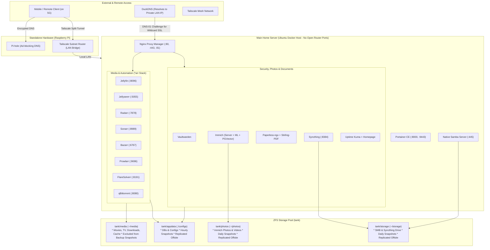

# 🏠 Automated Homelab & Media Server

A complete, production-grade homelab infrastructure managed via Docker Compose and native Linux services. Engineered around **ZFS snapshot efficiency**, **zero-copy atomic hardlinks (TRaSH Guides)**, **secure SSL reverse proxying without open router ports**, **native SMB network storage & Syncthing offline drive**, and **isolated DNS/VPN infrastructure**.

---

## 📑 Architecture Overview



---

## 🗂️ Services Directory

| Category | Service | Container Port | Host Port | Access URL | Purpose |
| :--- | :--- | :--- | :--- | :--- | :--- |
| **Proxy & Admin** | [Nginx Proxy Manager](https://nginxproxymanager.com) | `80`, `443`, `81` | `80:80`, `443:443`, `81:81` | `http://<ip>:81` | SSL termination & reverse proxy |
| | [Portainer CE](https://www.portainer.io) | `8000`, `9443` | `8000:8000`, `9443:9443` | `https://<ip>:9443` | Docker container management GUI |
| **Storage & Drive** | [Samba (Native SMB)](https://www.samba.org) | Host Native | `445`, `139` | `smb://<server-ip>/HomeDrive` | Personal cloud & Google Drive replacement |
| | [Syncthing](https://syncthing.net) | `8384` | `8384:8384` | `http://<ip>:8384` | Continuous file sync & offline drive |
| **Security** | [Vaultwarden](https://github.com/dani-garcia/vaultwarden) | `80` | Via NPM | `https://vault.<domain>` | Self-hosted Bitwarden password vault |
| **Photos & Documents** | [Immich](https://immich.app) | `2283` | `2283:2283` | `http://<ip>:2283` | Self-hosted Google Photos alternative |
| | [Paperless-ngx](https://docs.paperless-ngx.com) | `8000` | `8777:8000` | `http://<ip>:8777` | Document archival & OCR system |
| | [Stirling-PDF](https://github.com/Stirling-Tools/Stirling-PDF) | `8080` | `8085:8080` | `http://<ip>:8085` | Local PDF manipulation swiss-army knife |
| **Monitoring** | [Uptime Kuma](https://github.com/louislam/uptime-kuma) | `3001` | `3001:3001` | `http://<ip>:3001` | Service uptime & status page |
| | [Homepage](https://gethomepage.dev) | `3000` | `3000:3000` | `http://<ip>:3000` | Application dashboard |
| **Media Automation** | [Jellyfin](https://jellyfin.org) | `8096` | `8096:8096` | `http://<ip>:8096` | Open-source media streaming server |
| | [Jellyseerr](https://github.com/Fallenbagel/jellyseerr) | `5055` | `5055:5055` | `http://<ip>:5055` | Media request and discovery UI |
| | [Radarr](https://radarr.video) | `7878` | `7878:7878` | `http://<ip>:7878` | Movies collection automation |
| | [Sonarr](https://sonarr.tv) | `8989` | `8989:8989` | `http://<ip>:8989` | TV series collection automation |
| | [Bazarr](https://www.bazarr.media) | `6767` | `6767:6767` | `http://<ip>:6767` | Subtitle manager for Sonarr/Radarr |
| | [Prowlarr](https://prowlarr.com) | `9696` | `9696:9696` | `http://<ip>:9696` | Torrent/Usenet indexer proxy |
| | [qBittorrent](https://www.qbittorrent.org) | `8080`, `6881` | `8080:8080`, `6881:6881` | `http://<ip>:8080` | Torrent download client |
| | [FlareSolverr](https://github.com/FlareSolverr/FlareSolverr) | `8191` | `8191:8191` | `http://<ip>:8191` | Cloudflare challenge solver for indexers |

---

## 💾 Storage Architecture & ZFS Dataset Layout

The storage layout strictly separates **lightweight critical application state**, **personal photos**, **personal cloud documents**, and **disposable media**:

```
ZFS Storage Pool (tank)
├── tank/appdata (Mounted to ./configs inside ~/home-lab)
│   ├── Settings, SQLite databases (Vaultwarden, Sonarr, Radarr, Prowlarr)
│   ├── Immich PostgreSQL database & pgvector data
│   ├── Paperless SQLite metadata & NPM certificates
│   └──> SNAPSHOT THIS! (Lightweight, ~5-20 GB, hourly snapshots, replicated offsite)
│
├── tank/photos (Mounted to ~/photos)
│   ├── Immich photo and video libraries (family memories)
│   └──> SNAPSHOT & BACKUP THIS! (Daily snapshots, replicated offsite)
│
├── tank/storage (Mounted to ~/storage)
│   ├── Native Samba SMB share (Live network drive)
│   ├── Syncthing storage folder (Offline laptop sync)
│   └──> SNAPSHOT & BACKUP THIS! (Daily snapshots, replicated offsite)
│
└── tank/media (Mounted to ~/media)
    ├── downloads/       (qBittorrent active & completed downloads)
    ├── movies/          (Curated movie library)
    ├── tv/              (Curated TV show library)
    └── cache/
        ├── jellyfin/    (Transcoding chunks & image cache)
        └── immich-ml/   (Downloaded machine learning model cache)
    └──> EXCLUDED FROM BACKUP SNAPSHOTS (Multi-terabyte disposable media)
```

---

## 🚀 Step-by-Step Setup Guide

### Step 1: Host System & Dependencies Installation

On your fresh Ubuntu Server installation:

```bash
# Update system packages
sudo apt update && sudo apt upgrade -y

# Install Docker engine & Compose plugin
curl -fsSL https://get.docker.com | sh
sudo usermod -aG docker $USER

# Install ZFS utilities and Samba (for personal network drive)
sudo apt install -y zfsutils-linux samba

# Apply docker group changes to current session
newgrp docker

# Verify installations
docker --version
docker compose version
zfs --version
```

Verify your user UID and GID:

```bash
id -u  # Expected: 1000
id -g  # Expected: 1000
```

*(If different, update `PUID` and `PGID` in `.env`).*

---

### Step 2: ZFS Pool Creation

Identify your physical storage drives by their persistent disk IDs (avoid `/dev/sdX` which can change across reboots):

```bash
ls -l /dev/disk/by-id/
```

Create your ZFS storage pool named `tank`:

```bash
# For a mirrored drive setup (recommended for 2 drives):
sudo zpool create -o ashift=12 -O compression=lz4 tank mirror \
    /dev/disk/by-id/<drive-1-id> \
    /dev/disk/by-id/<drive-2-id>

# Or for a single drive setup:
# sudo zpool create -o ashift=12 -O compression=lz4 tank /dev/disk/by-id/<drive-id>

# Verify pool status
sudo zpool status tank
```

---

### Step 3: Clone Repository

Clone this repository into your home directory **before** creating the dataset mountpoints:

```bash
git clone <your-repo-url> ~/home-lab
cd ~/home-lab
```

---

### Step 4: Storage Datasets & Directory Preparation

Create the dedicated ZFS datasets with optimal filesystem tuning:

```bash
# 1. Appdata dataset (databases & container state: atime off, system attributes enabled)
sudo zfs create -o compression=lz4 -o atime=off -o xattr=sa -o mountpoint=/home/$USER/home-lab/configs tank/appdata

# 2. Photos dataset (Immich photo and video libraries: BACKED UP)
sudo zfs create -o compression=lz4 -o atime=off -o mountpoint=/home/$USER/photos tank/photos

# 3. Personal Cloud Storage dataset (SMB share & Syncthing offline drive: BACKED UP)
sudo zfs create -o compression=lz4 -o atime=off -o mountpoint=/home/$USER/storage tank/storage

# 4. Bulk Media dataset (1M recordsize for video streaming: EXCLUDED FROM BACKUP)
sudo zfs create -o compression=lz4 -o recordsize=1M -o mountpoint=/home/$USER/media tank/media

# 5. Create media subdirectories & isolated transcode caches
mkdir -p ~/media/downloads
mkdir -p ~/media/movies
mkdir -p ~/media/tv
mkdir -p ~/media/cache/jellyfin
mkdir -p ~/media/cache/immich-ml

# 6. Ensure all datasets belong to your user
sudo chown -R $USER:$USER /home/$USER/home-lab/configs /home/$USER/photos /home/$USER/storage /home/$USER/media
```

---

### Step 5: Personal Cloud Setup (SMB + Syncthing)

You have both **live network drive access (SMB)** and **offline two-way file synchronization (Syncthing)** operating on the exact same ZFS dataset (`~/storage`):

#### A. Configure Samba (SMB Share)

1. Edit `/etc/samba/smb.conf`:

```bash
sudo nano /etc/samba/smb.conf
```

2. Add this share definition to the bottom of the file:

```ini
[HomeDrive]
    comment = Personal Cloud Storage (ZFS)
    path = /home/%u/storage
    read only = no
    browsable = yes
    valid users = %u
    create mask = 0664
    directory mask = 0775
```

> [!TIP]
> **Client Username Matching**: Samba's `%u` macro expects the connecting client username to match the Linux server user. If connecting from macOS or Windows with a different username, replace `%u` with your specific Linux username (e.g. `path = /home/username/storage` and `valid users = username`).

3. Set your Samba password and restart the service:

```bash
sudo smbpasswd -a $USER
sudo systemctl restart smbd
```

*Connect from Windows (`\\<server-ip>\HomeDrive`), macOS (`smb://<server-ip>/HomeDrive`), or mobile files apps.*

#### B. Syncthing (Offline Sync)

* Open `http://<server-ip>:8384`.
* Syncthing mounts `/storage` directly to `~/storage`.
* Install the Syncthing client on your laptop. You can sync any folder to your laptop for offline modification (e.g. while traveling). As soon as you reconnect, changes sync back to the server and are automatically captured in your ZFS snapshots!
* **Prevent OS metadata clutter**: In the Syncthing folder settings, add the following to **Ignore Patterns** (`.stignore`) to prevent macOS/Windows desktop metadata files from propagating across devices:
  ```
  (?d).DS_Store
  (?d)Thumbs.db
  (?d)._*
  (?d).sync
  ```

---

### Step 6: Environment Configuration & Dashboard Templates

1. Copy the environment template:

```bash
cd ~/home-lab
cp example.env .env
chmod 600 .env
```

2. Edit `.env` with your secure credentials:

```bash
nano .env
```

* `SERVER_IP`: Your server's local LAN IP (e.g. `192.168.0.100`), used by Homepage dashboard links.
* `IMMICH_DB_PASSWORD`: Set a secure password (`openssl rand -hex 16`).
* `PAPERLESS_SECRET_KEY`: Set a secure secret key (`openssl rand -hex 16`).
* `VAULTWARDEN_DOMAIN`: Public URL (e.g. `https://vault.yourdomain.duckdns.org/`).
* `VAULTWARDEN_SIGNUPS_ALLOWED`: Default is `false`. Temporarily set to `true` to register your admin account, then revert to `false`.
* `DUCKDNS_KEY`: Your DuckDNS account token (used only inside NPM for DNS-01 SSL challenge).

3. Initialize Homepage dashboard configuration from starter templates:

```bash
mkdir -p ./configs/homepage/config
cp -r templates/homepage/* ./configs/homepage/config/
```

---

### Step 7: Launch the Stack

Validate and start the containers:

```bash
# Validate compose syntax
docker compose config

# Start all containers in detached mode
docker compose up -d

# Check running status
docker compose ps
```

---

### Step 8: Nginx Proxy Manager & SSL Setup (Private LAN Access)

> [!NOTE]
> **No Router Port Forwarding Required**: Your server is not exposed to the public internet. In your DuckDNS account, point `yourdomain.duckdns.org` to your server's **local LAN IP** (e.g. `192.168.0.x`). NPM uses the DuckDNS API TXT record (DNS-01 challenge) to issue a valid Let's Encrypt wildcard certificate without needing ports 80/443 open to the world!
>
> **DNS Rebinding Protection Note**: If your home router (e.g., pfSense, OpenWrt, FRITZ!Box) has DNS Rebinding Protection enabled, it may drop DNS responses for public domains that resolve to private LAN IPs. In your router settings, whitelist `duckdns.org` under DNS rebind exceptions or configure local DNS rewrites in Pi-hole.

1. Open `http://<server-ip>:81`.
2. Default login credentials:
   * **Email**: `admin@example.com`
   * **Password**: `changeme`
3. Immediately change your email and admin password when prompted.
4. **Create Wildcard Let's Encrypt Certificate**:
   * **SSL Certificates** → **Add SSL Certificate** → **Let's Encrypt**.
   * Domain Names: `*.yourdomain.duckdns.org`, `yourdomain.duckdns.org`.
   * Enable **Use a DNS Challenge** → Provider: **DuckDNS**.
   * Fill in your DuckDNS token and click **Save**.
5. **Add Proxy Hosts**:
   * Forward Hostname: Use internal container names (`vaultwarden`, `paperless-ngx`, `jellyfin`).
   * Forward Port: Corresponding container port (e.g., `80` for Vaultwarden, `8000` for Paperless).
   * Under the **SSL** tab: Select your Wildcard Certificate, enable **Force SSL**, **HTTP/2**, and **Websockets Support**.

---

### Step 9: Core Services Initial Setup

1. **Vaultwarden**:
   * Access `https://vault.yourdomain.duckdns.org` and register your master vault account.
   * Lock signups: Edit `.env`, set `VAULTWARDEN_SIGNUPS_ALLOWED=false`, and run:
     ```bash
     docker compose up -d vaultwarden
     ```
2. **Immich**:
   * Open `http://<server-ip>:2283` and create the administrator account.
   * Photos upload directly to `~/photos` (`tank/photos`) and are fully included in daily snapshots and backups!
3. **Paperless-ngx**:
   * Open `http://<server-ip>:8777`.
   * Create an administrator user:
     ```bash
     docker compose exec -it paperless-ngx python3 manage.py createsuperuser
     ```

---

### Step 10: Media Stack & TRaSH Hardlinks

1. **qBittorrent (`http://<server-ip>:8080`)**:
   * **Password**: Retrieve the initial randomized password:
     ```bash
     docker compose logs qbittorrent | grep -i password
     ```
   * Log in (`admin` / `<temporary-password>`), change password in **Tools** → **Options** → **Web UI**.
   * In **Tools** → **Options** → **Downloads**:
     * Default Save Path: `/data/downloads`
     * Incomplete Save Path: `/data/downloads/incomplete`
2. **Sonarr (`:8989`) & Radarr (`:7878`)**:
   * **Root Folders**: Add `/data/movies` (Radarr) and `/data/tv` (Sonarr).
   * **Download Client**: Add qBittorrent (`host: qbittorrent`, `port: 8080`).
   * **Category**: Set category to `tv` in Sonarr and `movies` in Radarr.
3. **Jellyfin (`:8096`)**:
   * Library paths: `/data/movies` and `/data/tv` (mounted read-only to safeguard media files).
   * **Dashboard** → **Playback** → **Transcoding**: Transcode path set to `/cache` (routes to `~/media/cache/jellyfin`).

*(For the complete guide on indexers, subtitle automation, and GPU transcoding, see [docs/media-stack-guide.md](docs/media-stack-guide.md)).*

---

### Step 11: Standalone Raspberry Pi (Pi-hole + Tailscale)

Keep home DNS online 100% of the time, even during server maintenance:

1. Flash Raspberry Pi OS Lite on your Pi, assign a static DHCP reservation (e.g. `192.168.0.50`).
2. Install Pi-hole: `curl -sSL https://install.pi-hole.net | bash`.
3. Install Tailscale, enable Linux IP forwarding, and advertise your home LAN subnet:
   ```bash
   sudo tailscale up --advertise-routes=<your-lan-subnet> --accept-dns=false
   ```
4. Set Pi-hole as Tailscale's global DNS server.
5. On mobile devices outside your home, connect via Tailscale to access your SMB drive, Syncthing, Immich, and server web UIs seamlessly.

*(For detailed step-by-step instructions, see [docs/pihole-tailscale-guide.md](docs/pihole-tailscale-guide.md)).*

---

### Step 12: Automated ZFS Snapshots & Recovery

All container state resides in `tank/appdata`, photos reside in `tank/photos`, and personal documents reside in `tank/storage`:

```bash
# Take a manual snapshot of all critical datasets
sudo zfs snapshot tank/appdata@manual-$(date +%F)
sudo zfs snapshot tank/photos@manual-$(date +%F)
sudo zfs snapshot tank/storage@manual-$(date +%F)

# List snapshots
sudo zfs list -t snapshot
```

To configure automated snapshot retention with Sanoid and offsite replication with Syncoid, see [docs/zfs-backup-guide.md](docs/zfs-backup-guide.md).
